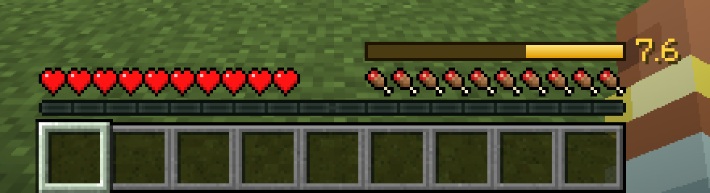
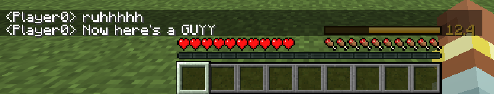
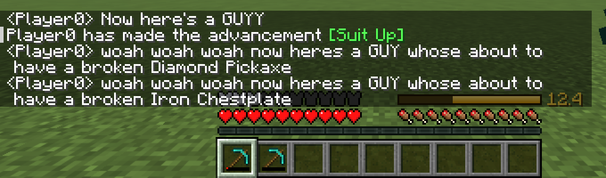

# Saturation Guy

[](https://github.com/RettWilson22/saturation-guy/actions/workflows/build.yml)

A Fabric mod for Minecraft Java 26.3. It puts your saturation on screen (the hidden
hunger stat that decides how fast you get hungry) and adds a few chat callouts.



## What it does

- **Saturation bar.** A gold bar above your hunger bar with the exact number next to it.
  It fills from the right like the hunger bar, and the air bubbles move up to make room.
- **"ruhhhhh".** When your saturation hits 0, you say `ruhhhhh` in chat.
- **"Now here's a GUYY".** When another player hurts you (melee, arrow, trident, splash
  potion), you say it in chat. There's a 3 second cooldown so a PvP fight doesn't get you
  kicked for spam.
- **Durability warning.** When a tool, weapon or armor piece drops to 5% durability, you
  say `woah woah woah now heres a GUY whose about to have a broken <item>`. Once per item.
- **Copy coordinates.** Press **N** to copy your block coordinates to the clipboard.

Press **J** to turn the number and the "ruhhhhh" message on or off. Both keys can be
rebound under Options > Controls > Key Binds.




## Install

1. Install [Fabric Loader](https://fabricmc.net/use/installer/) for 26.3.
2. Download `saturation-guy-1.3.0.jar` from
   [Releases](https://github.com/RettWilson22/saturation-guy/releases) and
   [Fabric API](https://modrinth.com/mod/fabric-api) for 26.3.
3. Put both jars in your `mods` folder (`.minecraft/mods` on Windows and Linux,
   `~/Library/Application Support/minecraft/mods` on macOS) and launch the Fabric profile.

## Why the bar can be off on some servers

The server only tells your client your saturation when your health or hunger changes, so
the client's copy goes stale while it drains in the background (sprinting at full health,
for example). When the mod is also on the server, it sends the real value every tick it
changes, using a custom packet that only goes to clients that have the mod. Vanilla
clients never see it.

| Where you play | Saturation bar | Chat callouts |
|---|---|---|
| Singleplayer or LAN | Exact | Yes |
| Server with the mod | Exact | Yes |
| Any other server | Vanilla's copy, refreshes on health or hunger changes | Yes |

The callouts only need the mod on your side.

## How it's put together

| File | What it does |
|---|---|
| `SaturationBar` | HUD element drawn after the food bar. Registered as a status bar so other bars stack above it. |
| `SaturationSync`, `SaturationPayload` | Server side: sends saturation when it changes, only to players who have the mod. |
| `ClientPacketListenerMixin` | Hooks the damage and health packets on the client, after they reach the game thread. |
| `GuyCallout`, `RuhCallout`, `DurabilityCallout` | The three chat messages, each with its own guard against repeats. |
| `SaturationGuyConfig` | Remembers the J toggle in `config/saturationguy.properties`. |

A few things that took some care:

- The client starts every new player object at a placeholder saturation of 5.0 until the
  server's first update, so `RuhCallout` treats that first update as a baseline. Otherwise
  joining a world at 0 saturation would trigger "ruhhhhh".
- Swapping two of the same tool in an open inventory looks exactly like one slot wearing
  down, so the durability check pauses while an inventory screen is open.
- A renamed item can have characters chat won't accept, or a name long enough to push the
  message past the chat limit, so the item name is cleaned and the message trimmed first.

## Building

Needs Java 25.

```sh
./gradlew build
```

The jar ends up in `build/libs/`. On macOS without a separate JDK, `./build.sh` uses the
Java 25 runtime that comes with the Minecraft launcher.

There's an automated client test that starts the game and checks that the client gets the
exact saturation, that each message fires once (and not again on rejoin), and saves
screenshots along the way (the ones above come from it):

```sh
./gradlew runClientGameTest
```

## License

MIT
